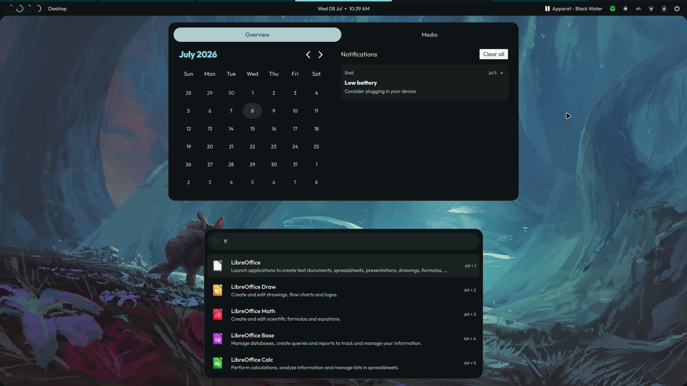

# Desktop Shell

A [Quickshell](https://quickshell.outfoxxed.me/) based UI for the [Niri](https://github.com/YaLTeR/niri) Wayland compositor.

> **Note:** The older AGS (Aylur's GTK Shell) version of this config is available on the [`ags/main`](https://github.com/hashankur/desktop-shell/tree/ags/main) branch.

## Preview

Top bar with workspace indicators, system stats, clock, media, tray, wifi, battery, and power button. Fullscreen overlays for launcher, clipboard, dashboard, and power menu.



## Features

- **Top bar**: per-screen, with workspace strip (niri or umbriel), CPU/RAM/GPU/temp rings, focused window, clock, next-event chip, media, system tray, WiFi, battery, power button
- **App launcher**: fuzzy search over desktop entries, keyboard navigation, Alt+number shortcuts
- **Clipboard history**: `cliphist`-backed picker
- **Dashboard**: tabbed overlay with calendar, notification history, usage graphs, and media controls
- **Appearance page** (`02 Appearance` in the Settings window): default scheme, or [matugen](https://github.com/InioX/matugen) colors generated from a wallpaper; switching repaints the shell live
- **Wallpaper picker**: browse `~/Pictures/Wallpapers` and hand the image to [awww](https://github.com/LGFae/awww) (`spawn-at-startup` from niri), with a fade transition
- **Calendar**: ICS feeds (Google Calendar secret address or any ICS URL) with per-feed event colors, dots on the month grid, click a day to drill into its events
- **Next-event dot**: event-colored dot beside the clock (plus `in 21m` once a start is within 30 minutes); hover opens a card with title, time range, countdown and an in-progress bar; click opens the dashboard
- **Notifications**: dismiss, click-to-invoke actions; critical urgency gets sticky toasts, error accent, and DND bypass
- **OSD**: volume, microphone, and brightness (single shared pill)
- **Power menu**: lock, logout, suspend, shutdown, restart, firmware setup

## Roadmap

- Built-in lock screen (Quickshell libraries instead of an external locker)
- Light scheme (`matugen image -m light`); the HUD is tuned for dark and needs a pass before light is offered

## Requirements

| Dependency | Purpose |
|---|---|
| [Quickshell](https://quickshell.outfoxxed.me/) >= 0.3.0 | Shell framework |
| [Niri](https://github.com/YaLTeR/niri) | Wayland compositor |
| [qml-niri](https://github.com/imiric/qml-niri) | QML plugin (`import Niri`) for workspaces / window state |
| [cliphist](https://github.com/sentriz/cliphist) | Clipboard history |
| [wl-clipboard](https://github.com/bugaevc/wl-clipboard) | `wl-copy` for clipboard writes |
| [curl](https://curl.se/) | Calendar feed fetching |
| [matugen](https://github.com/InioX/matugen) | Wallpaper-derived color schemes |
| [awww](https://github.com/LGFae/awww) | Wallpaper daemon (started by niri, driven by the shell) |
| [MoreWaita](https://github.com/somepaulo/MoreWaita) | Icon theme |

## Installation

```sh
git clone https://github.com/hashankur/desktop-shell.git ~/.config/quickshell/neue
```

Ensure the required dependencies are installed, then launch with the command below.

## Usage

```sh
qs -c neue -d
```

The shell auto-reloads on file changes.

### Calendar events

Create `~/.config/quickshell/calendar.json` with your ICS feed URLs (Google Calendar: *Settings → your calendar → Integrate with third-party apps*, use the secret address in iCal format):

```json
{
  "feeds": [
    {
      "url": "https://calendar.google.com/calendar/ical/your.address%40gmail.com/private-abc123/basic.ics",
       "color": "#039BE5"
    }
  ]
}
```

### Theme

Colors live in `~/.config/quickshell/appearance.json`, written by the shell when you pick a scheme on the Appearance page of the Settings window (the `Settings` tag in the console header, or `quickshell ipc call theme toggle`). Delete the file to fall back to the built-in default scheme:

```json
{
  "colors": { "primary": "#ff5e1f", "surface": "#0d2557" },
  "themeMode": "default",
  "wallpaper": "/home/you/Pictures/Wallpapers/example.jpg"
}
```

Keys you leave out keep their defaults, so a partial file is valid. Everything outside `colors` stays in `config/Appearance.qml`.

### IPC

```sh
# Toggle app launcher (also: open, close)
quickshell ipc --path ~/.config/quickshell/neue/shell.qml call launcher toggle

# Toggle clipboard history (also: open, close)
quickshell ipc --path ~/.config/quickshell/neue/shell.qml call clipboard toggle

# Toggle power menu (also: open, close)
quickshell ipc --path ~/.config/quickshell/neue/shell.qml call powermenu toggle

# Toggle dashboard (also: open, close); jump to a tab with: openView overview|system (Status tab)|mpris
quickshell ipc --path ~/.config/quickshell/neue/shell.qml call dashboard toggle

# Toggle the Settings window on the Appearance page (also: open, close)
quickshell ipc --path ~/.config/quickshell/neue/shell.qml call theme toggle

# Toggle the Settings window on the Quick page (also: open, close)
quickshell ipc --path ~/.config/quickshell/neue/shell.qml call quicksettings toggle

# Open the Settings window on a page (also: toggle, open, close); pages: quick|network|bluetooth|appearance
quickshell ipc --path ~/.config/quickshell/neue/shell.qml call settings openPage appearance
```

Bind these to compositor keybindings for keyboard-driven access.
